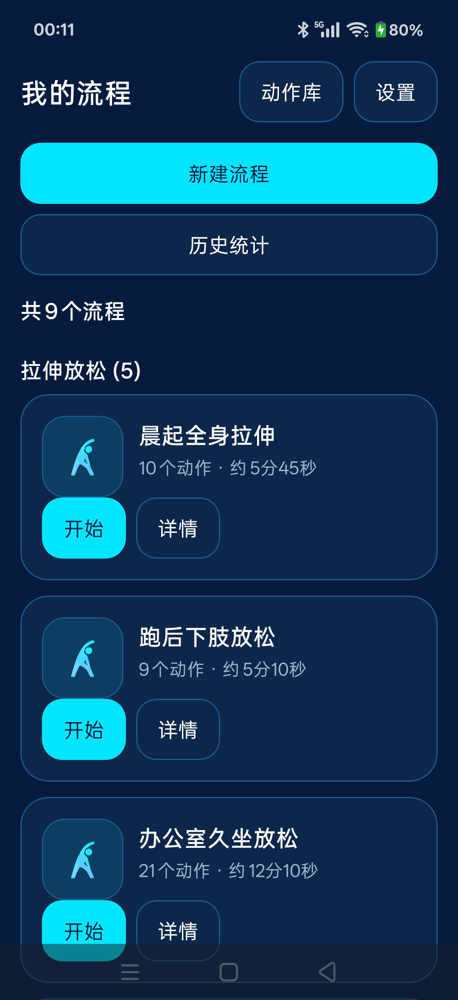

# 拉伸语音播报

跟着语音做完一组拉伸：每个动作报名字、提示要领和换边，手不用碰手机；练完能按流程看到自己累计练了多久。

[English](./README.en.md) · [安卓安装包（蒲公英）](https://www.pgyer.com/lashenyuyinbobao)



## 这是什么

一个在 Android 手机上离线运行的拉伸语音教练。它把一串动作编成流程，按节拍逐个播报，到了换边、休息、结束都会出声提醒；屏幕只显示当前动作和剩余时间，不需要一直盯着。

语音是提前生成好的本地音频，锁屏、切后台也能继续播；不联网、不登录、不上传练习记录。

## 能做什么

- **离线语音流程**：每个动作播报名称、要领与换边提示，配合本地音频包，不依赖系统 TTS 或网络。
- **动作库与流程编排**：按拉伸、热身、核心等训练类型组织动作，可编排自己的流程。
- **换边与休息提示**：单边动作到点提醒换边，组间休息倒计时，自动进入下一段。
- **前台服务保活**：锁屏与切后台时继续播放，通知栏可暂停/继续/结束。
- **历史统计**：只记录有可信时间源的练习时长，按训练类型累计并显示最近 10 条；可单删或清空。
- **中英双语界面**：首启跟随系统语言，设置页可手动切换，选择在重启后保留。
- **零账号零联网**：数据只存本机 SQLite。

## 安装与运行

真机安装：从[蒲公英](https://www.pgyer.com/lashenyuyinbobao)下载最新 APK，覆盖安装即可保留数据。

从源码运行需要 Node.js 20+ 与 Android Studio：

```bash
npm install
npm test              # jest 单元测试
npm run typecheck
npx expo run:android  # 连接真机编译安装
```

正式包使用固定签名；升级请覆盖安装，不要卸载。

## 数据与隐私

- 练习记录只存在本机，卸载即删除；没有云同步与账号体系。
- 音频资源随包分发，播放过程不请求网络。
- 仓库与文档不含真实用户练习数据。

## 已知限制

- 历史统计从开启统计后开始计，旧版本没有历史表，无法回溯。
- 结束方式如果不标准（中途强杀），该次可能不计入统计，界面会说明。
- 目前只维护 Android 端。

## 目录

```text
app/         # 页面与导航
features/    # 流程、播放、历史统计
domain/      # 动作、流程与计时模型
services/    # 语音、前台服务、通知
assets/audio # 预生成语音与提示音
docs/        # 产品计划、验收、交接与治理记录
```

产品范围见 `docs/pm/PRODUCT_PLAN_V1.3.md`，变更记录见 `CHANGELOG.md`。
